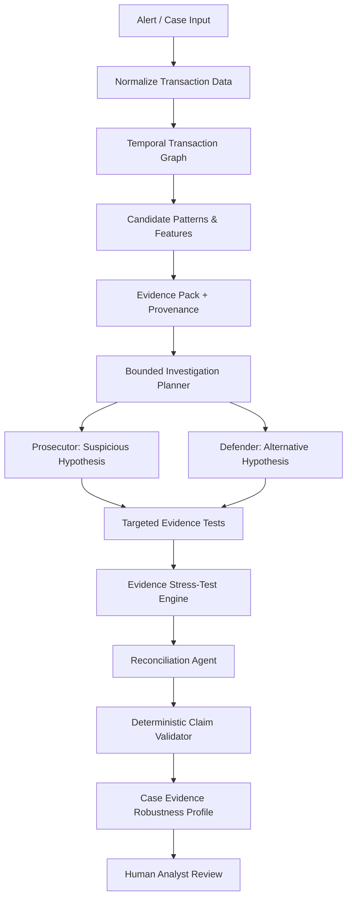

# RingTrace — Final Project Master, Submission Copy & Deployment Blueprint

## Evidence-Grounded Financial Crime Investigation with Adversarial Case Stress-Testing

**Version:** Final reviewed project master\
**Track fit:** Agentic AI / FinTech\
**Target event:** K! Hacks 4.0 — Team Twilight\
**Round 1 deadline:** 26 November 2026 (confirm portal cutoff and timezone)\
**Status:** Submission-ready concept and implementation blueprint. This document does not represent a deployed or production-validated software system.

------------------------------------------------------------------------

# Executive Verdict

RingTrace is a strong hackathon idea because it addresses the
investigation stage *after* a suspicious transaction alert is generated.
It is not just a graph anomaly detector and not merely an LLM that
writes an AML narrative. Its intended value is to organize evidence,
test competing hypotheses, expose evidence gaps and contradictions, and
help an analyst review a case.

However, the original "Prosecutor + Defender + Judge + deterministic
validator" architecture is **not by itself novel**. Recent AML/fraud
work already explores multi-agent investigation, transaction-level
grounding, deterministic verification, independent checking, graph
analysis, and case-report generation. RingTrace must avoid claiming that
these components are individually new.

The most defensible differentiator is a **bounded, case-level
investigation protocol** that combines: 1. temporal transaction-network
evidence assembly; 2. explicit competing, falsifiable hypotheses; 3.
targeted evidence acquisition rather than unconstrained agent debate; 4.
case-level stress tests for provenance, chronology, contradictions,
missing context, and sensitivity to pivotal evidence; 5. a structured
**Case Evidence Robustness Profile** that separates verified facts,
interpretations, counter-evidence, unknowns, and conclusions that are
fragile to particular assumptions; 6. evaluation against detector-only
and single-agent baselines using fixed case data and matched
investigation budgets.

This is a proposed contribution---not a claim of unprecedented
invention. Its novelty must be demonstrated by an implemented protocol
and experiments, not by renaming agents.

------------------------------------------------------------------------

# 1. Project Identity

## Name

**RingTrace**

## Tagline

**Trace the flow. Challenge the hypothesis. Verify the evidence.**

## Expanded title

**RingTrace: Evidence-Grounded, Adversarial AI for Financial Crime
Investigation**

## Domain

Agentic AI · FinTech · AML investigation support · Transaction graphs ·
Explainable AI · Responsible AI

## Project type

A post-alert investigation and evidence-quality decision-support
prototype.

## Intended users

-   AML and financial-crime analysts
-   Compliance operations teams
-   FinTech/payment risk investigators
-   AML technology vendors (as potential integration users)

## Mission

Help analysts turn suspicious transaction alerts into structured,
reviewable investigations in which suspicious interpretations are
challenged, source records are verified, evidence gaps are surfaced, and
uncertainty is not hidden.

## Vision

Move from alert-centric triage to evidence-led investigation---without
replacing the human investigator or pretending that a graph anomaly
proves criminal intent.

------------------------------------------------------------------------

# 2. Problem Statement

Financial institutions can receive suspicious transaction alerts from
rules, anomaly-detection models, or graph-based monitoring systems. An
alert is a starting point---not an investigation or proof of wrongdoing.

Investigators may need to reconstruct flows across accounts, establish
transaction chronology, collect supporting records, consider legitimate
explanations, inspect contradictory evidence, and prepare documentation.
These tasks can be fragmented and repetitive. AI-generated summaries can
further introduce unsupported claims, misstate transaction details, or
convert a pattern into an overconfident narrative.

**RingTrace focuses on the post-alert investigation gap:** helping an
investigator systematically examine why a case was flagged, what the
records actually establish, which competing explanations remain
plausible, what information is missing, and how robust the case
narrative is to key evidence.

## Core problem statement

> Suspicious transaction alerts can be difficult to interpret when
> activity spans interconnected accounts, multiple transaction paths,
> temporal patterns, incomplete context, and potentially legitimate
> explanations. Analysts must manually reconstruct the flow, verify
> records, challenge assumptions, and document findings. RingTrace
> proposes an evidence-grounded investigation workflow that tests
> competing hypotheses and exposes evidence integrity, contradictions,
> gaps, and uncertainty before human review.

## Problem boundaries

RingTrace does **not**: - decide whether a person is guilty; - prove
that money laundering occurred; - autonomously freeze, block, or report
accounts; - replace a bank's AML monitoring or case-management system; -
claim that all false positives can be eliminated.

It supports an investigator's review of a synthetic case.

------------------------------------------------------------------------

# 3. Why Existing Solutions Are Not Enough --- and What We Can Claim

## 3.1 Competitive landscape

The following landscape is based on a preliminary research scan. It is
not a comprehensive market audit, and the listed research differs in
maturity, evaluation, and publication status.

### A. Multi-agent AML investigation and narrative generation

Research frameworks such as Co-Investigator AI explore specialized agent
roles in AML investigation, information gathering, typology analysis,
narrative generation, and compliance review. Therefore, "we have several
AML agents" is not a defensible novelty claim.

### B. Evidence-ledger agents with deterministic verification

The October 2026 preprint **ELMI: Evidence-Ledger Multi-Agent
Investigation for Traceable AML Reporting** proposes an evidence ledger,
tool-return-limited citations, field-by-field deterministic checking,
independent verification, and synthetic benchmarking. This is a very
close overlap with RingTrace's previous evidence-grounding and validator
claims. RingTrace must not claim evidence-ledger validation alone as its
unique contribution.

### C. Verifier-grounded fraud detection

**VR-FraudNet (2026)** combines graph-based modeling, ML triage,
constrained rationale generation, deterministic verification, and
calibration. This overlaps with the notion of using structured evidence
and deterministic verification to support AI explanations.

### D. AML triage with evidence retrieval and counterfactual checks

Recent research investigates evidence retrieval, counter-evidence,
missing information, and counterfactual checking for AML triage. Thus,
counterfactual checks or "show both sides" are not unique on their own.

### E. Agentic fraud investigation and collaboration benchmarking

Other studies evaluate multi-agent collaboration strategies for fraud
evidence aggregation, factual consistency, evidence recall,
hallucination rates, and traceability. Agent debate, role
specialization, and evaluation of report quality are already active
topics.

### F. Graph-based AML detection

Graph-based detection of cycles, layering, fan-in/fan-out, transaction
clusters, behavioral anomalies, and suspicious subgraphs is an
established research direction. RingTrace's graph detector should be
treated as a supporting component, not its primary novelty.

## 3.2 Competitive overlap matrix

  ------------------------------------------------------------------------
  Capability                   Existing work already RingTrace should
                                        explores it? position it as
  --------------------- ---------------------------- ---------------------
  Graph-based                                    Yes Supporting alert/case
  transaction anomaly                                discovery
  detection                                          

  Cycle / layering /                             Yes Pattern coverage, not
  fan-in / fan-out                                   novelty
  extraction                                         

  AML multi-agent                                Yes Controlled workflow
  workflow                                           implementation

  Agent role                                     Yes Engineering design
  specialization                                     choice

  AI investigation                               Yes User-facing output
  narrative                                          

  Evidence citations /                           Yes Required safety
  grounding                                          mechanism

  Deterministic record                           Yes Integrity requirement
  validation                                         

  Independent AI                                 Yes Optional
  verifier                                           baseline/ablation
                                                     component

  Counter-hypothesis /                           Yes Incorporated into
  counterfactual                                     structured tests
  checking                                           

  Human review                                   Yes Governance
                                                     requirement

  Case-level evidence        Related robustness work Candidate RingTrace
  sensitivity tests     exists; specific integration contribution, to be
                                   must be validated carefully scoped and
                                                     experimentally tested

  Evidence robustness   Similar ingredients exist in Proposed product
  profile                 reliability/explainability output; avoid
                         systems; not an established absolute novelty
                                    unique invention claims
  ------------------------------------------------------------------------

## 3.3 What the competition judges should hear

Do **not** say: \> "No existing AML solution has multi-agent reasoning
or evidence verification."

Do say: \> "Existing research is already advancing agentic AML
investigation and verifier-grounded explanations. RingTrace focuses on
making the post-alert investigation explicitly testable: it assembles a
time-respecting evidence pack, generates competing hypotheses, performs
bounded evidence-acquisition tasks and case-level stress tests, and
exposes which findings are supported, contradicted, missing, or
sensitive to pivotal evidence. We will test whether this workflow adds
measurable value over detector-only and single-agent baselines."

That is a more credible and defensible positioning.

------------------------------------------------------------------------

# 4. RingTrace's Core Ideology

## The shift

**Old framing:** Detect a suspicious network, then have agents debate
it.

**Refined framing:** A suspicious hypothesis must survive a structured
investigation. RingTrace does not reward a persuasive narrative; it
records what was verified, what challenges it, what is unknown, and what
changes if a pivotal piece of evidence is removed or altered within a
controlled test.

## Core philosophy

1.  **Alert is not proof.** An anomaly triggers investigation; it does
    not establish criminality.
2.  **Facts and interpretations stay separate.** A transaction record is
    a fact; a typology label is an interpretation.
3.  **Challenge is mandatory.** The system actively tests plausible
    legitimate explanations.
4.  **Tool results outrank generated narrative.** Agent claims must
    reference evidence returned by controlled tools.
5.  **Validation has limits.** Deterministic checks can validate IDs,
    fields, arithmetic, paths, and chronology---not criminal intent.
6.  **Unknown is a legitimate result.** Missing data or unresolved
    conflict must not be hidden.
7.  **Human accountability stays intact.** The platform prepares a
    review package; a human makes consequential decisions.

## One-line ideology

> **RingTrace investigates the alert by testing the strength of its
> evidence---not by making its suspicion sound more convincing.**

------------------------------------------------------------------------

# 5. Proposed Core Innovation: Case Evidence Stress-Testing

RingTrace's proposed signature mechanism is a structured case-level
stress-testing protocol. The individual tests are known concepts; the
contribution is the defined integration, workflow, representation, and
evaluation---not an assertion that the tests are new algorithms.

## Stress test 1 --- Provenance integrity

-   Does each cited transaction ID exist?
-   Do cited amounts, sender, receiver, and timestamps match the source?
-   Are derived values reproducible?
-   Can the claim be linked to its source record?

**Deterministic.**

## Stress test 2 --- Temporal consistency

-   Is the proposed flow chronologically possible?
-   Are timestamps used correctly?
-   Does a purported sequential path violate time order?
-   Are windows and time-zone assumptions documented?

**Deterministic where source timestamps and rules are available.**

## Stress test 3 --- Competing hypothesis test

-   What suspicious explanation fits the observed pattern?
-   What legitimate explanation could plausibly fit?
-   What available data supports or weakens each?
-   What additional evidence would help distinguish them?

**Agent-assisted with controlled evidence retrieval.**

## Stress test 4 --- Contradiction and missing-context test

-   Does any evidence conflict with the proposed interpretation?
-   What required context is unavailable?
-   Are missing fields treated as unknown rather than assumed?
-   Are multiple summaries of the same source incorrectly treated as
    independent evidence?

**Tool-supported plus analyst/agent review.**

## Stress test 5 --- Pivotal-evidence sensitivity

-   Which transaction, metric, path, or assumption most affects the case
    interpretation?
-   Does the review recommendation change if a pivotal item is excluded
    in a controlled analysis?
-   Is the case disproportionately dependent on one record or one
    feature?
-   Is that dependence clearly disclosed?

This test must be designed carefully. Removing a transaction for
sensitivity analysis does not imply the transaction is false or should
be ignored. It is a controlled diagnostic of dependency.

**Deterministic perturbation + structured reassessment.**

## Proposed output

A **Case Evidence Robustness Profile (CERP)**---renamed from "Case
Defensibility Profile" to avoid suggesting that the system certifies
legal defensibility.

The profile contains: - Verified observations - Evidence supporting the
suspicious hypothesis - Evidence supporting alternative hypotheses -
Contradictions - Missing information - Evidence provenance status -
Chronology/path integrity - Pivotal evidence dependencies - Sensitivity
results - Recommendation and uncertainty

This is a transparent case-quality view, not a guilt or risk
probability.

------------------------------------------------------------------------

# 6. System Architecture

## Pipeline



## Architecture modules

  -----------------------------------------------------------------------
  Layer                   Module                  Purpose
  ----------------------- ----------------------- -----------------------
  1                       Ingestion               Load and normalize
                                                  synthetic transactions

  2                       Temporal graph          Represent accounts and
                                                  transactions as
                                                  time-aware directed
                                                  relationships

  3                       Candidate detector      Extract potentially
                                                  suspicious patterns

  4                       Evidence pack           Freeze source
                                                  references, paths,
                                                  metrics, and data
                                                  provenance

  5                       Investigation planner   Choose bounded tasks
                                                  and evidence queries

  6                       Prosecutor              Build testable
                                                  suspicious hypothesis

  7                       Defender                Retrieve and test
                                                  alternative
                                                  explanations

  8                       Stress-test engine      Run deterministic
                                                  integrity tests and
                                                  controlled sensitivity
                                                  analysis

  9                       Reconciler              Assess both sides,
                                                  gaps, contradictions,
                                                  uncertainty

  10                      Claim validator         Check factual claims
                                                  against records and
                                                  computed outputs

  11                      Analyst workspace       Visualize the case and
                                                  allow review/editing
  -----------------------------------------------------------------------

------------------------------------------------------------------------

# 7. Agent Roles and Guardrails

## Agent 1 --- Investigation Planner

**Purpose:** Plan the investigation and choose the next useful bounded
query.

Inputs: - Alert metadata - Evidence pack - Available tool inventory -
Investigation budget

Outputs: - Hypotheses to test - Tool calls to request - Stop criteria -
Unresolved questions

Guardrails: - No unlimited agent loops - No unauthorized data access -
No repeated calls without new information - Budget and time limits

## Agent 2 --- Prosecutor / Suspicious-Hypothesis Builder

**Purpose:** Construct a testable suspicious-activity hypothesis from
verified evidence.

Tasks: - Identify transaction-flow patterns - Examine chronology and
connected accounts - Cite source transaction IDs and computed metrics -
Separate facts from interpretations - State which additional evidence
would strengthen or weaken the hypothesis

Guardrails: - Cannot invent account context, amounts, relationships, or
intent - Cannot treat a graph pattern as proof of laundering - Claims
must be structured and checked

## Agent 3 --- Defender / Alternative-Hypothesis Challenger

**Purpose:** Actively attempt to weaken the suspicious hypothesis.

Tasks: - Generate relevant alternative hypotheses - Search for
supporting data through permitted tools - Test whether a legitimate
explanation fits observed facts - Identify contradictions and evidence
gaps - Recommend discriminating evidence

Guardrails: - Do not fabricate salary, occupation, business, customer
intent, or other profile context - A plausible alternative is not
automatically evidence of innocence - Defender performance is judged on
relevance and evidence quality, not number of alternatives

## Agent 4 --- Reconciliation Agent

**Purpose:** Reconcile the evidence---not vote or force a verdict.

Inputs: - Verified Prosecutor claims - Verified Defender claims -
Stress-test results - Evidence ledger - Unknowns

Outputs: - Supported observations - Competing interpretations -
Contradictions - Missing information - Sensitivity caveats - Review
recommendation

Permitted workflow states: - `ESCALATE_FOR_HUMAN_REVIEW` -
`DISMISS_ALERT_FOR_REVIEW` - `INSUFFICIENT_EVIDENCE` -
`REQUEST_MORE_INFORMATION`

The status is a workflow suggestion only.

## Deterministic validator (not an AI agent)

Checks: - Transaction IDs - Exact record fields - Amounts and
timestamps - Account references - Path edge validity - Chronological
constraints - Metric arithmetic - Claim-to-evidence mappings - Schema
conformance

It does **not** validate: - Criminal intent - Legal conclusions -
Whether a typology interpretation is necessarily correct - Whether the
source data is itself truthful

------------------------------------------------------------------------

# 8. Transaction Graph and Pattern Detection

RingTrace should cover more than literal cycles.

## Candidate pattern families

-   Cycles / circular movement
-   Multi-hop layering chains
-   Fan-in aggregation
-   Fan-out distribution
-   Rapid pass-through
-   Burst activity
-   Unusual account connectivity
-   Fragmented transaction patterns
-   Behavioral deviations from available history

These are **indicators**, not evidence of guilt.

## Initial detector approach

Use an implementable prototype: - Directed temporal transaction graph -
NetworkX / Pure Python graph engine - Rules and graph metrics - Temporal path extraction -
Flow/velocity features - Optional LightGBM baseline

Avoid making a GNN or federated learning system a core dependency unless
experiments show clear benefit.

------------------------------------------------------------------------

# 9. Evidence Pack and Data Contracts

Agents should not freely pass narratives as if they were facts. They
should access a shared, versioned evidence pack.

## Evidence pack contents

-   Case ID / alert ID
-   Dataset version
-   Transaction references
-   Account references
-   Time window
-   Graph nodes and edges
-   Valid time-respecting paths
-   Pattern indicators
-   Programmatically calculated metrics
-   Supporting observations
-   Contradicting observations
-   Missing fields/context
-   Source provenance
-   Validation status

## Structured claim example

``` json
{
  "claim_id": "CL-014",
  "claim_type": "temporal_observation",
  "statement": "Account A forwarded funds shortly after receiving them.",
  "evidence_ids": ["TX-101", "TX-105"],
  "metric_ids": ["MET-008"],
  "interpretation": "rapid_pass_through_pattern",
  "validation_status": "pending"
}
```

Validator checks that IDs and values match, and the computed temporal
relationship is correct.

The phrase "this is suspicious" is an interpretation, not a
deterministically verified fact. The system must label it accordingly.

------------------------------------------------------------------------

# 10. End-to-End Workflow

1.  **Alert intake:** A transaction, account, alert, or candidate
    subgraph is selected.
2.  **Normalization:** Validate required columns, data types,
    timestamps, and duplicates.
3.  **Graph construction:** Build a time-aware directed graph.
4.  **Candidate extraction:** Detect patterns and compute relevant
    metrics.
5.  **Evidence pack:** Freeze case evidence and source references.
6.  **Hypothesis generation:** Produce testable suspicious and
    alternative hypotheses.
7.  **Investigation planning:** Select evidence queries with bounded
    tool permissions.
8.  **Adversarial investigation:** Prosecutor and Defender investigate
    using tools.
9.  **Stress testing:** Verify provenance, chronology, contradictions,
    missing context, and pivotal evidence sensitivity.
10. **Reconciliation:** Judge evaluates verified claims,
    counter-evidence, gaps, and uncertainty.
11. **Claim validation:** Reject or flag unsupported factual statements.
12. **Case output:** Produce the Case Evidence Robustness Profile.
13. **Human review:** Analyst reviews, edits, dismisses, requests
    information, or escalates.

------------------------------------------------------------------------

# 11. Case Evidence Robustness Profile (CERP)

The proposed profile replaces simplistic AI confidence.

## Example --- synthetic illustration only

**Case:** RT-1042\
**Pattern:** Rapid multi-hop flow\
**Workflow status:** Human review required

  -----------------------------------------------------------------------
  Dimension                           Example status
  ----------------------------------- -----------------------------------
  Transaction references              Verified

  Chronology                          Verified

  Graph path                          Valid for supplied records

  Suspicious hypothesis               Some evidence supports pattern

  Alternative hypothesis              Partially tested

  Contradicting evidence              Present

  Missing context                     Counterparty/business context
                                      unavailable

  Pivotal dependency                  One transaction materially affects
                                      interpretation

  Sensitivity                         Recommendation changes under
                                      controlled exclusion test

  Final workflow state                Requires more information / analyst
                                      review
  -----------------------------------------------------------------------

## Visual representation

Use a compact panel with: - **Verified:** green/neutral check -
**Challenged:** evidence or claim in conflict - **Unknown:** missing
context - **Sensitive:** conclusion materially changes under a
controlled test

Avoid presenting an aggregate "defensibility score" unless a meaningful,
validated weighting scheme is developed. Prefer separate dimensions that
cannot conceal weaknesses.

------------------------------------------------------------------------

# 12. Dataset and Data Strategy

## Candidate dataset

Explore a public synthetic AML transaction dataset such as AMLSim /
AMLworld HI-Small, subject to dataset version and license.

Before implementation, confirm: - Exact columns and transaction types -
Whether labels are transaction-level, account-level, or scenario-level -
Available timestamps - Available typology labels - Whether bank IDs/silo
attributes exist - Licensing and attribution requirements

## Data limitations

-   Synthetic behavior may be easier to detect than real-world financial
    crime.
-   Real legitimate business context may be absent.
-   Simulator labels do not equal legal findings.
-   Bank partitions are not equivalent to actual independent banks.
-   Label leakage can invalidate the evaluation.

## Experimental controls

-   Use temporal splitting when the data supports it.
-   Do not use labels in live detection features.
-   Keep test labels hidden from agents.
-   Prevent future transactions from entering features.
-   Match the same case evidence and tool budget across baselines.
-   Report dataset limitations clearly.

------------------------------------------------------------------------

# 13. Evaluation and Research Hypothesis

## Main research question

> Does a bounded adversarial investigation workflow with case-level
> evidence stress-testing improve factual grounding, counter-hypothesis
> coverage, evidence-gap reporting, and analyst usefulness compared with
> detector-only and single-agent baselines?

## Hypothesis

RingTrace will improve evidence-supported claim quality and
counter-hypothesis coverage and will better expose contradictions and
pivotal-evidence sensitivity than a single-LLM investigation baseline.
These benefits will be measured against additional latency, token cost,
tool calls, and review burden.

This is a **hypothesis to test**, not an assumed result.

## Baselines

### A --- Detector-only

Graph/rule/model alert and structured pattern output.

### B --- Single-LLM investigator

Same evidence pack, tools, and factual validator; one agent prepares the
investigation.

### C --- RingTrace

Same case data and comparable tool budget; planner, Prosecutor,
Defender, targeted stress tests, reconciliation, and validator.

## Metrics

  -----------------------------------------------------------------------
  Metric                              Definition / purpose
  ----------------------------------- -----------------------------------
  Citation/field validity             Cited record and fields match
                                      source

  Unsupported-claim rate              Factual claims not supported by
                                      supplied records

  Evidence coverage                   Relevant known evidence captured

  Counter-hypothesis quality          Alternative relevance, support, and
                                      discriminating tests

  Contradiction detection             Relevant conflicts correctly
                                      surfaced

  Missing-context reporting           Material unknowns reported rather
                                      than assumed

  Sensitivity disclosure              Pivotal dependencies and result
                                      changes reported

  Recommendation quality              Agreement with case-level reference
                                      labels, with abstention allowed

  Analyst usefulness                  Human review ratings and edits, if
                                      feasible

  Latency                             Time to case output

  Cost                                Model/API cost per case

  Tool efficiency                     Useful queries vs redundant calls

  Precision / Recall / F1 / PR-AUC    Detection baseline performance
  -----------------------------------------------------------------------

For imbalanced AML data, do not use accuracy alone. Report precision,
recall, F1, PR-AUC, false-positive rate, and performance at a matched
alert budget where feasible.

## Evaluation fairness

-   Use identical evidence access across variants.
-   Match token/tool budgets where feasible.
-   Include ablations: no Defender, no stress tests, no validator, no
    sensitivity test.
-   Repeat runs and report variation.
-   Use deterministic evaluation where possible.
-   Have human review samples of generated claims.
-   Avoid relying solely on another LLM as the judge.

------------------------------------------------------------------------

# 14. Hackathon Feasibility and Scope

## Build priority

### Must-have (MVP)

-   Synthetic dataset loader
-   Data validation
-   Directed temporal transaction graph
-   Two or three pattern detectors
-   Evidence pack
-   One controlled investigation workflow
-   Prosecutor and Defender with structured outputs
-   Deterministic evidence validator
-   Basic sensitivity test
-   Case profile UI
-   One baseline comparison

### Should-have

-   Judge/reconciler
-   More pattern types
-   Graph visualization
-   Case report export
-   Multi-case comparison
-   Ablation results

### Optional extension

-   Federated learning simulation
-   More sophisticated graph model
-   Advanced cross-case memory
-   Cross-bank partitioning
-   Real-time streaming

**Do not let federated learning, elaborate GNNs, multi-bank simulation,
or a complex backend block the core demo.**

------------------------------------------------------------------------

# 15. Technology Stack

  -----------------------------------------------------------------------
  Layer                   Suggested technology    Why
  ----------------------- ----------------------- -----------------------
  Language                Python                  Data, graph, agent and
                                                  evaluation logic

  Data                    Pandas or DuckDB / JSON Efficient transaction
                                                  preprocessing

  Graph                   NetworkX / Pure Python  Transparent,
                                                  hackathon-friendly
                                                  graph analysis

  Agent workflow          LangGraph or a bounded  State, tool control,
                          custom state machine    retries, stopping

  Structured outputs      Pydantic                Validate schemas and
                                                  agent outputs

  LLM                     One provider/model      Control cost and
                          initially               simplify evaluation

  API                     FastAPI                 Serve cases and
                                                  investigation results

  Frontend                React / Modern Web UI   Case workspace

  Graph UI                Cytoscape.js / D3 / SVG Interactive transaction
                                                  graph

  Persistence             SQLite or DuckDB        Prototype case records
                                                  and results

  Audit events            Append-only JSONL for   Inspect tool calls and
                          demo                    validation results

  Metrics                 Python evaluation       Reproducible baseline
                          scripts                 comparisons
  -----------------------------------------------------------------------

## Engineering principles

-   No unrestricted agent loops.
-   Fixed investigation budget and timeout.
-   Tool permissions per agent.
-   Transaction descriptions treated as untrusted data.
-   Schema-validated outputs.
-   Deterministic computation where possible.
-   Logs for agent actions, tool returns, validations, and handoffs.
-   No real customer data in the hackathon prototype.

------------------------------------------------------------------------

# 16. Responsible AI, Security, and Failure Modes

  -----------------------------------------------------------------------
  Risk                                Mitigation
  ----------------------------------- -----------------------------------
  Hallucinated transaction facts      Tool-return-only evidence; field
                                      validation

  Invalid graph path                  Verify every edge and temporal
                                      constraint

  Confirmation bias                   Explicit alternative hypothesis and
                                      evidence retrieval

  Defender invents innocent context   Require source support; mark
                                      unverified assumptions

  Agent prompt injection in           Treat memo as untrusted content,
  transaction memo                    never instructions

  Evidence leakage between cases      Case-scoped tool permissions and
                                      data boundaries

  Endless agent debate                Max rounds, token/tool budget, stop
                                      conditions

  False certainty                     Unknown, contradiction, and
                                      sensitivity states

  Synthetic-data overclaim            Clearly disclose simulation and
                                      limits

  Misleading legal interpretation     No guilt/legal conclusion; human
                                      review

  Sensitive data exposure             Synthetic data, least privilege,
                                      minimization

  Validator overreach                 Separate factual validation from
                                      typology/intent judgment
  -----------------------------------------------------------------------

------------------------------------------------------------------------

# 17. Market and Business Model

## Target segment

-   Banks
-   FinTech/payment providers
-   AML investigation teams
-   Financial crime compliance operations
-   AML platform providers

## Positioning

RingTrace is an **investigation quality and evidence review layer**, not
a replacement for transaction monitoring.

## Potential value

-   Less repetitive transaction tracing and evidence organization
-   More consistent case structure
-   Faster identification of evidence gaps
-   Explicit competing hypotheses
-   More transparent case summaries
-   Improved audit reviewability

These are potential benefits to validate, not proven savings.

## Potential models

-   B2B SaaS per analyst/team
-   Enterprise private deployment
-   API integration with existing AML platforms
-   Paid proof-of-concept/pilot
-   Custom deployment for data-sensitive institutions

## Adoption barriers

-   Data access and integration
-   Security and privacy requirements
-   Model governance and explainability review
-   Analyst trust and usability
-   False-positive and false-negative risks
-   Regulatory expectations

------------------------------------------------------------------------

# 18. Unique Selling Points (Refined)

## USP 1 --- Structured adversarial case investigation

RingTrace doesn't just generate a suspicious narrative; it requires a
competing explanation to be tested using permitted evidence.

## USP 2 --- Pivotal evidence sensitivity

The system exposes whether an investigation interpretation materially
depends on one transaction, metric, or assumption through controlled
sensitivity tests.

## USP 3 --- Evidence and interpretation are separated

Source facts, computed metrics, agent interpretations, and unknowns
remain distinct in the case record.

## USP 4 --- Case-level evidence robustness profile

Analysts see supporting evidence, counter-evidence, contradictions,
gaps, and sensitivity---not only a risk/confidence score.

## USP 5 --- Bounded, auditable agent workflow

Agent permissions, tool calls, state transitions, evidence references,
validation results, and stopping conditions are inspectable.

**These USPs are design claims until implemented and evaluated.** Do not
describe them as measured performance improvements in Round 1.

------------------------------------------------------------------------

# 19. Demo Plan (2.5--3 Minutes)

## 0:00--0:25 --- Problem

"An AML alert is not a completed investigation. Analysts must
reconstruct flows, verify records, challenge the suspicion, and document
the case."

## 0:25--0:55 --- Transaction graph

Show synthetic accounts and a time-respecting transaction path. Explain
the detector's alert using concrete records.

## 0:55--1:30 --- Evidence pack

Show transaction IDs, values, timestamps, flow metrics, source links,
and which observations are facts vs interpretations.

## 1:30--2:00 --- Adversarial investigation

Prosecutor constructs the suspicious hypothesis. Defender tests a
legitimate explanation and retrieves relevant evidence. Display tool
results, not just agent chat.

## 2:00--2:30 --- Stress tests

Show: - invalid reference rejected; - chronology checked; -
contradictory evidence surfaced; - sensitivity to a pivotal transaction
disclosed.

## 2:30--3:00 --- Case Evidence Robustness Profile

Show supported evidence, counter-evidence, missing context, sensitivity,
and human review recommendation.

**Closing line:** "RingTrace doesn't ask AI to make the accusation more
convincing. It makes the investigation challenge itself---and shows the
analyst exactly what the evidence can and cannot support."

------------------------------------------------------------------------

# 20. Final Round 1 Submission Copy (Paste-Ready)

Transfer the content below into the corresponding fields of the official K! Hacks template. Preserve the organizer's exact field names, order, word limits and formatting rules. Do not add sections if the template prohibits them.

## 20.1 Title

**RingTrace: Evidence-Tested Investigation of Suspicious Transaction Rings**

## 20.2 Tagline

**Trace the flow. Challenge the hypothesis. Verify the evidence.**

## 20.3 Problem (plain language)

When a bank's monitoring system flags suspicious activity, the alert is only the beginning of an investigation. Financial crime can involve funds moving through multiple accounts, making it difficult to understand the complete flow from individual transactions. Analysts must reconstruct transaction paths, examine supporting records, consider legitimate explanations, identify missing information and document their findings. This process can be time-consuming, especially when evidence is fragmented across accounts and transaction records. AI-generated summaries introduce another risk: they may present suspicious interpretations with more confidence than the available evidence justifies.

Detection systems such as RBI's MuleHunter.AI demonstrate the growing use of AI to identify potential mule accounts. RingTrace addresses a complementary problem: helping investigators examine the evidence behind an alert and understand what it does—and does not—support. Verify the latest RBI implementation figure against the original RBI publication before including a number.

## 20.4 Who it helps

AML and fraud analysts at banks and payment companies, financial-crime investigation teams, and compliance professionals. RingTrace aims to improve investigation quality and help reduce unsupported interpretations that could affect customers.

## 20.5 Our solution in one sentence

RingTrace converts a suspicious-transaction alert into an evidence-tested investigation file, showing verified records, suspicious and alternative explanations, contradictions, missing information and the transactions on which an interpretation depends—while leaving every final decision to a human analyst.

## 20.6 How it works

1. **Evidence pack:** Load transaction records, construct a time-aware account graph, identify candidate flow patterns such as multi-hop chains, cycles, fan-in, fan-out and rapid pass-through, and create a traceable case snapshot. Transaction totals, hop counts and graph properties are computed by code.
2. **Prosecutor agent:** Builds a suspicious-activity hypothesis as structured, testable claims linked to specific transaction records.
3. **Defender agent:** Challenges the hypothesis by querying available case data for plausible alternative patterns, such as recurring payments or business payouts. It must cite retrieved records and cannot invent customer or business information.
4. **Evidence stress tests:** Deterministic checks verify transaction references, amounts, chronology, graph-path consistency, contradictions, missing fields and sensitivity to pivotal evidence.
5. **Reconciler:** Combines supported claims, counter-evidence and unresolved gaps without forcing a definitive verdict.
6. **Claim validator:** Rejects claims that cite nonexistent records or fail defined data-consistency checks. It does not claim to verify intent or legal conclusions.
7. **Case Evidence Robustness Profile (CERP):** Produces a concise report showing verified facts, supporting evidence, counter-evidence, contradictions, unknowns, provenance status and pivotal-evidence dependencies.
8. **Human review:** The analyst reviews, edits, accepts or rejects the system's recommendations. RingTrace does not autonomously freeze accounts or file regulatory reports.

## 20.7 Example

Funds move through 10 accounts over 48 hours. RingTrace's temporal graph pattern engine identifies a multi-hop transaction chain. The Prosecutor identifies rapid pass-through as a suspicious pattern and cites six transfers. The Defender queries the available transaction records and finds recurring fixed payments involving two intermediate accounts. These provide a plausible alternative explanation that requires further investigation—not proof of legitimate activity.

The stress-testing engine identifies one transaction as pivotal to the suspicious interpretation. In a controlled sensitivity test, it examines how the interpretation changes when that transaction is excluded from the diagnostic case view. It also identifies missing account-purpose and source-of-funds information. The validator rejects a Prosecutor claim that references a transaction ID absent from the case evidence.

The resulting report distinguishes verified observations, a challenged interpretation, missing-context items and a pivotal-evidence dependency. Instead of receiving an unsupported AI conclusion, the analyst receives a traceable investigation summary and specific questions for follow-up.

**Important:** This is an illustrative synthetic scenario, not a claim about measured system performance.

## 20.8 What is new

Existing research explores agentic AML reporting, evidence-grounded investigation and counterfactual explanation. RingTrace does not claim that multiple agents or evidence citations are new by themselves.

Its proposed contribution is a bounded, case-level evidence stress-testing workflow that combines time-aware transaction paths, competing hypotheses, deterministic claim validation, contradiction and missing-context analysis, and pivotal-evidence sensitivity reporting. We will evaluate whether this combination improves investigation quality compared with detector-only and single-agent approaches under matched conditions. This is a proposed contribution that must be demonstrated experimentally, not a claim of being the first system to use any individual component.

## 20.9 How we will prove it works

We will evaluate RingTrace using synthetic AML transaction scenarios with known ground truth and deliberately introduced defects, including incorrect amounts, impossible timestamps, fabricated transaction IDs and missing contextual information.

We will compare three approaches using the same cases and comparable evidence and tool budgets:

- **A. Detector only:** Identifies suspicious transaction patterns without agent-based investigation.
- **B. Single-agent investigator:** Uses one AI investigator with access to the same evidence and validation tools.
- **C. RingTrace:** Uses bounded Prosecutor–Defender investigation, deterministic stress tests, reconciliation and claim validation.

Evaluation metrics include planted-defect detection rate by defect type, unsupported-claim rejection rate, citation validity, evidence-gap identification, counter-hypothesis coverage, pivotal-evidence sensitivity disclosure, false-positive defect flags, investigation time and tool cost. We will report results transparently, including cases where RingTrace does not outperform the baselines. Defect-detection metrics will be reported separately from investigative-reasoning quality.

## 20.10 Tech stack

Python, Pandas or DuckDB, NetworkX for temporal transaction graphs, optional LightGBM for a detector baseline, an LLM API with structured JSON output, Pydantic for schema validation, FastAPI for backend services, and React with Cytoscape.js or Streamlit for the investigation interface. An append-only audit log will record agent actions, tool calls and validation outcomes.

## 20.11 Data

We plan to use public synthetic AML transaction data, including IBM's AML dataset, subject to verifying the selected version, data fields, attribution requirements and license. IBM describes its generated AML data as synthetic rather than anonymized real customer records. Verify the exact dataset and license from its original repository before use. No real customer data will be used in the prototype.

## 20.12 Feasibility

The 24-hour prototype will prioritize one complete investigation workflow: transaction ingestion, evidence-pack generation, temporal graph construction, Prosecutor and Defender tool calls, deterministic stress tests, claim validation, a Reconciler and the final report profile. Additional graph patterns, advanced detectors and richer visualizations will be implemented only after the core workflow works end to end. Cross-bank federated learning, advanced graph neural networks and real-time streaming are roadmap features, not dependencies for the prototype.

## 20.13 Limitations

Synthetic transaction data may not represent the complexity of real financial institutions. Deterministic checks validate record references, arithmetic and defined consistency rules; they cannot establish criminal intent or prove that a transaction is illicit. Alternative explanations are hypotheses, not proof of innocence. The prototype is an investigation-support tool, not a replacement for compliance professionals or regulatory processes. Results from a hackathon prototype are preliminary and do not establish production readiness.

## 20.14 Roadmap

Future development may explore privacy-preserving cross-institution learning, real-time alert integration, advanced transaction-network analytics and integration with financial-crime case-management systems.

## 20.15 Team

- **Team:** Twilight
- **Institution:** Saveetha Engineering College
- **Track:** Agentic AI / FinTech
- **Team size:** 4

Enter the actual member names and details in the official organizer template. Suggested workstreams: transaction graph and data; agent orchestration and tool design; validation and evaluation; backend, interface and demo integration. Assign roles according to the team's actual skills and availability.

---

# 21. Research Sources and Competitive Positioning

## 21.1 Closest related work to review

The following are research leads for the literature review. Verify the current title, author list, version, publication status and full methodology from the original source before adding formal citations to a submission. Do not rely on search snippets or secondary summaries for detailed capability claims.

1. **Co-Investigator AI: The Rise of Agentic AI for Smarter, Trustworthy AML Compliance Narratives** — [arXiv:2509.08380](https://arxiv.org/abs/2509.08380). Related agentic AML work involving specialized agents and compliance narratives. It is a relevant comparison for multi-agent AML workflows; do not claim it lacks evidence validation without reviewing the full paper.
2. **Explainable AML Triage with LLMs: Evidence Retrieval and Counterfactual Checks** — [arXiv:2604.19755](https://arxiv.org/abs/2604.19755). A close research lead for evidence retrieval and counterfactual AML triage. Verify the actual manuscript version and results before relying on detailed claims or metrics.
3. **LLM reasoning over financial transaction graphs** — [arXiv:2507.14785](https://arxiv.org/abs/2507.14785). Relevant to graph-structured financial reasoning and explanations. Do not misclassify this as a conventional graph neural network detector without checking the paper.
4. **From Tasks to Teams: A Risk-First Evaluation Framework for Multi-Agent LLM Systems in Finance (M-SAEA)** — [ACL Anthology](https://aclanthology.org/2026.findings-acl.1934/). Relevant to evaluating multi-agent financial workflows and system-level risk.
5. **A Survey of Intelligent Anti-Money Laundering Techniques: From Detection Models to Generative Agents** — [DOI:10.19678/j.issn.1000-3428.0260981](https://doi.org/10.19678/j.issn.1000-3428.0260981). Broad background on AML approaches; verify bibliographic details and scope.

Do not cite the previously mentioned ELMI preprint by name unless the original paper and its bibliographic record can be independently located and verified. It is not required to establish RingTrace's positioning.

## 21.2 Conservative competitive comparison

| Capability | Agentic AML narrative systems | Evidence-retrieval / counterfactual triage | Graph-based detection and reasoning | RingTrace proposal |
|---|---|---|---|---|
| Agent-based workflow | Present in some systems | Varies by method | Not necessarily | Bounded multi-agent workflow |
| Transaction graph analysis | Method-dependent | May use case evidence or subgraphs | Common focus | Time-aware graph as evidence foundation |
| Evidence-linked claims | Described in relevant work | Central to evidence-grounded approaches | Method-dependent | Required for each factual claim |
| Alternative explanations | Verify per paper | Counterfactual checks in relevant work | Not usually the primary output | Tool-using Defender tests alternatives |
| Deterministic record validation | Varies; verify full text | Varies; verify full text | Method-dependent | Explicit claim and path validator |
| Pivotal-transaction sensitivity profile | Not established from abstract alone | Related counterfactual concept; exact overlap must be checked | Not typical detector output | Proposed case-level diagnostic |
| Human-reviewable case profile | Narrative/report outputs exist | Triage outputs exist | Often detection-oriented | Separates facts, interpretations, counter-evidence and unknowns |
| Matched-baseline planted-defect evaluation | Varies | Varies | Often detection metrics | Explicit evaluation plan |

This table describes broad research directions, not exhaustive feature audits of every paper. The exact overlap must be checked in each full paper. The final rows describe RingTrace's proposed design and evaluation, not proof that no prior system has done something similar.

## 21.3 Defensible differentiation

RingTrace should emphasize the proposed integration of:

1. Time-respecting, multi-account transaction reconstruction.
2. Bounded competing-hypothesis investigation with actual evidence queries.
3. Deterministic checks on individual claims and transaction paths.
4. Case-level sensitivity analysis of pivotal transactions.
5. A structured report separating observations, interpretations, counter-evidence and unknowns.
6. An experimental evaluation designed to test evidence defects and investigation quality separately.

The contribution is the protocol, its implementation and its evaluation. Do not claim that multi-agent reasoning, graph analytics, evidence retrieval, counterfactuals or deterministic validation are individually novel.

## 21.4 External data and institutional references

- **IBM AML synthetic data:** Use the original IBM repository and read its dataset-specific license and attribution requirements before downloading or redistributing data. Do not assume that the repository's software license automatically applies to every dataset file.
- **RBI MuleHunter.AI:** If mentioning deployment counts or bank coverage, cite the exact RBI annual report or official RBI publication and preserve its reporting date. Avoid treating detection deployment as proof that RingTrace's investigation workflow is absent from all deployed systems.
- **Industry false-positive rates:** Do not use a universal "90%+" figure unless a primary source defines the population, period, alert type and false-positive measurement. The current submission does not need this statistic.

---

# 22. Limitations and Honest Claims

RingTrace cannot: - prove money laundering; - reliably infer criminal
intent from graph structure alone; - guarantee zero hallucinations or
zero false positives; - generalize from synthetic data to production
without validation; - claim that multi-agent systems always outperform
single-agent systems; - claim that deterministic citation checks
establish the correctness of interpretations; - replace regulated
investigators or institution-specific AML processes.

The prototype can demonstrate: - temporal graph construction; - selected
flow-pattern detection; - structured evidence retrieval; -
evidence-backed hypothesis generation; - alternative-hypothesis
testing; - deterministic record/path validation; - controlled
sensitivity tests; - case-level reporting; - comparative baseline
evaluation.

------------------------------------------------------------------------

# 23. Hackathon Perspective --- Critical Rating

## RingTrace's current concept score

  ------------------------------------------------------------------------
  Judging dimension                            Score Why
  --------------------- ---------------------------- ---------------------
  Problem relevance                           9.0/10 Important and
                                                     credible FinTech
                                                     investigation
                                                     workflow

  Track alignment                             9.5/10 Strong Agentic AI fit
                                                     if agents use tools
                                                     and adapt

  Innovation                                  7.5/10 Core components
                                                     overlap with recent
                                                     AML agent/verifier
                                                     research

  Differentiation                             8.7/10 Case-level
  potential                                          stress-testing and
                                                     sensitivity profile
                                                     are promising if
                                                     implemented

  Technical depth                             9.0/10 Graphs, evidence
                                                     contracts, tools,
                                                     validation,
                                                     evaluation

  Feasibility in                              8.0/10 Full scope is too
  hackathon                                          large; strict MVP
                                                     needed

  Demo potential                              9.2/10 Excellent visual
                                                     storytelling and
                                                     visible agent actions

  Impact                                      8.7/10 Helps review quality,
                                                     but operational
                                                     benefits need testing

  Business value                              8.0/10 Clear enterprise
                                                     user, adoption
                                                     barriers remain

  Presentation                                9.0/10 Strong narrative:
  potential                                          alert → investigate →
                                                     challenge → verify
  ------------------------------------------------------------------------

### Overall idea score: **8.8/10**

This is a concept-level rating, not a prediction of winning. Final
results depend on the exact problem statement in Round 2, implementation
quality, team execution, judging criteria, and competing projects.

## What could push it above 9?

-   Implement the stress-test protocol---not just agent personas.
-   Make the evidence validator demonstrably catch manipulated or
    incorrect claims.
-   Show a real Defender tool call that changes or challenges the
    initial hypothesis.
-   Report a baseline experiment rather than making unsupported
    improvement claims.
-   Keep the demo focused and polished.
-   Explain clearly why the case profile is more useful than a
    confidence score.

## Main risk

The project could be judged as "another AML multi-agent chatbot" if the
Defender, validator, sensitivity test, and evidence profile are just UI
labels or LLM prompts without working, deterministic behavior.

------------------------------------------------------------------------

# 24. Freeze / Don't Add More Features

## Freeze the core

-   Transaction graph
-   Candidate flow patterns
-   Evidence pack
-   Bounded investigation
-   Prosecutor
-   Defender
-   Targeted evidence queries
-   Evidence stress tests
-   Reconciliation
-   Deterministic validator
-   Case Evidence Robustness Profile
-   Human review
-   Baseline comparison

## Optional only

-   Federated learning
-   Advanced GNN
-   Cross-bank simulation
-   Real-time streaming
-   Cross-case agent memory
-   Complex external intelligence integrations

The project is now conceptually complete. More features will dilute it
and hurt feasibility.

------------------------------------------------------------------------

# 25. Implementation and Deployment Blueprint

This section is an engineering handoff for building and deploying the prototype. It is not a statement that the application has already been implemented, security-tested or deployed. Use synthetic data only in the hackathon build.

## 25.1 Recommended prototype architecture

```text
Browser UI (React + Cytoscape.js)
          |
          v
FastAPI application
          |
          +--> Case ingestion and schema validation
          +--> Temporal graph / pattern engine (NetworkX)
          +--> Evidence pack and immutable case snapshot
          +--> Bounded investigation orchestrator
          |       +--> Prosecutor (LLM, structured output)
          |       +--> Defender (LLM + read-only evidence tools)
          |       +--> Reconciler (LLM, constrained synthesis)
          +--> Deterministic stress-test and claim validator
          +--> CERP report generator
          |
          +--> SQLite or DuckDB (prototype case data)
          +--> Append-only audit events (JSONL or database table)
```

Keep graph calculations, source lookup, arithmetic, chronology checks, schema validation and claim-to-record matching in deterministic code. LLMs may propose hypotheses and summarize validated evidence, but must not invent transaction facts or calculate authoritative totals.

## 25.2 Core API contract

Suggested endpoints for the prototype:

| Method | Endpoint | Purpose |
|---|---|---|
| POST | `/api/cases` | Create a case from a validated synthetic transaction file |
| GET | `/api/cases/{case_id}` | Retrieve case metadata and processing status |
| GET | `/api/cases/{case_id}/graph` | Retrieve nodes, edges and time-aware path data |
| POST | `/api/cases/{case_id}/investigate` | Start one bounded investigation run |
| GET | `/api/cases/{case_id}/evidence` | Retrieve evidence pack and source references |
| GET | `/api/cases/{case_id}/report` | Retrieve CERP report |
| GET | `/api/cases/{case_id}/audit` | Retrieve ordered audit events |

These are proposed contracts. Implement only the endpoints required by the final UI; do not spend hackathon time building unused API surface.

## 25.3 Canonical transaction schema

At minimum, normalize each transaction into:

```json
{
  "transaction_id": "TX-000001",
  "timestamp": "2026-01-01T10:15:00Z",
  "source_account": "ACC-001",
  "destination_account": "ACC-002",
  "amount": 1250.50,
  "currency": "INR",
  "transaction_type": "transfer",
  "source_record_id": "SRC-000001"
}
```

The schema is illustrative. Adapt it to the selected dataset's actual fields and preserve original source identifiers. Validate required fields, timestamp parsing, positive/allowed amount rules, currency handling and unique transaction IDs. Never silently fabricate missing account purpose, customer identity or source-of-funds fields; represent them as unknown or unavailable.

## 25.4 Structured claim contract

Every agent-generated factual claim should include:

```json
{
  "claim_id": "CLM-001",
  "claim_type": "rapid_pass_through",
  "statement": "Funds moved through the cited accounts within the configured time window.",
  "transaction_ids": ["TX-000001", "TX-000002"],
  "supporting_evidence_ids": ["EV-001", "EV-002"],
  "counter_evidence_ids": [],
  "confidence_label": "provisional",
  "unknowns": ["account_purpose"]
}
```

The validator must check that cited IDs exist in the frozen case snapshot, fields match the underlying records, derived values are reproducible and temporal/path rules are satisfied. Confidence labels are communication aids, not calibrated probabilities unless calibration is separately measured.

## 25.5 Bounded agent policy

- One investigation planner call per case run.
- One Prosecutor pass and one Defender pass.
- A fixed, small number of read-only evidence-tool calls per agent.
- One Reconciler pass after deterministic stress tests.
- No open-ended agent loops or unrestricted internet access.
- Every tool call records case ID, tool name, query parameters, result IDs and timestamp.
- The Defender may report that no supporting alternative evidence was found; it must not invent a legitimate explanation.
- The Reconciler must preserve unresolved contradictions and may return `INSUFFICIENT_EVIDENCE`.

Set exact call and token budgets in configuration and record them in experiment results.

## 25.6 CERP output contract

The report should contain separate fields for:

- Case summary and synthetic-data notice.
- Verified observations and their transaction/evidence IDs.
- Suspicious hypothesis and supporting records.
- Alternative hypothesis and supporting records, if any.
- Counter-evidence and contradictions.
- Missing fields and unavailable context.
- Provenance and chronology validation results.
- Pivotal evidence dependencies and sensitivity-test result.
- Unresolved questions and recommended next information to obtain.
- Suggested workflow status: `ESCALATE_FOR_HUMAN_REVIEW`, `CLOSURE_REVIEW`, `INSUFFICIENT_EVIDENCE`, or `REQUEST_MORE_INFORMATION`.
- Human reviewer decision, kept separate from AI-generated recommendations.

Do not generate a guilt score or present the workflow status as a legal or regulatory finding.

## 25.7 Environment configuration

Keep secrets outside source control. A local `.env.example` may include placeholders such as:

```dotenv
APP_ENV=development
DATABASE_URL=sqlite:///./ringtrace.db
LLM_PROVIDER=your_provider
LLM_API_KEY=replace_me
LLM_MODEL=replace_with_supported_model
MAX_AGENT_TOOL_CALLS=6
MAX_INVESTIGATION_SECONDS=120
CASE_DATA_MODE=synthetic_only
```

Do not commit real API keys, customer data, production database credentials or private transaction records. Validate all environment variables at application startup and fail safely if required configuration is missing.

## 25.8 Local run and deployment sequence

1. Create a Python virtual environment and install pinned backend dependencies from a committed requirements/lock file.
2. Install frontend dependencies from a committed lock file.
3. Copy `.env.example` to a local `.env` and provide a development-only LLM key if required.
4. Load only the approved synthetic dataset and run schema validation.
5. Run unit tests for graph paths, arithmetic, timestamps, claim references and validator rejection cases.
6. Run integration tests for the full bounded agent workflow, including missing LLM response, malformed JSON, tool timeout and empty evidence results.
7. Start the FastAPI backend and frontend using documented development commands.
8. Deploy the backend and frontend to the team's chosen hosting platform only after the environment variables, CORS policy, request limits and logs are configured.
9. Run a smoke test using a synthetic case and verify the graph, agent trace, validator rejection and CERP report.
10. Record the deployed commit/version, dataset version, model name, configuration and known limitations in the demo notes.

Exact hosting commands depend on the platform selected by the team; do not publish a deployment URL until it has been tested.

## 25.9 Minimum test suite before demo

- Valid transaction file ingests and preserves source IDs.
- Duplicate transaction ID is rejected or explicitly handled.
- Invalid amount and malformed timestamp are caught.
- A time-impossible path is flagged.
- A fabricated transaction ID in an agent claim is rejected.
- A valid claim links to the correct record and reproducible calculation.
- Defender queries return actual evidence IDs, not invented context.
- Missing contextual fields remain unknown.
- Pivotal-evidence sensitivity output states exactly what was changed and what changed in the result.
- LLM timeout or malformed output fails safely without fabricating a report.
- Audit events preserve the order of actions and validation outcomes.
- Human reviewer action is explicit and not silently inferred.

## 25.10 Security and operational boundary

The hackathon version must use synthetic data and read-only tools. Do not connect it to live banking systems, payment rails, customer identity systems or production case-management systems. Treat transaction descriptions and uploaded files as untrusted input; constrain tool access to the current case; sanitize rendered text; apply upload size/type limits; and prevent prompt-injection text inside records from changing system instructions. Restrict access to the demo environment and do not expose API keys in browser code or logs.

A real deployment would require institution-specific security review, privacy/legal assessment, access controls, encryption, retention policy, audit governance, model-risk validation, monitoring, incident response and integration approvals. The hackathon prototype is not production-ready for regulated financial-crime operations.

---

# 26. Final Pitch

> **RingTrace transforms suspicious financial transaction alerts into
> evidence-tested investigation cases. Instead of allowing AI to merely
> explain why activity looks suspicious, it assembles time-respecting
> transaction evidence, develops competing hypotheses, tests those
> hypotheses through controlled evidence queries, and stress-tests the
> case for factual integrity, chronology, contradictions, missing
> context, and pivotal-evidence sensitivity. Its Case Evidence
> Robustness Profile shows analysts what is supported, challenged,
> unknown, and fragile---keeping consequential decisions
> human-controlled.**

## Short pitch (30 seconds)

> AML systems can flag suspicious activity, but the alert is only the
> beginning. RingTrace investigates the alert using transaction graphs
> and evidence-grounded AI agents. A Prosecutor builds the suspicious
> hypothesis, a Defender tests legitimate alternatives using evidence,
> and a stress-test engine checks chronology, source integrity,
> contradictions, and sensitivity to key transactions. The system
> produces a transparent case profile---not an automated accusation---so
> investigators can see exactly what the evidence supports and what
> still needs review.

------------------------------------------------------------------------

# Final verdict

**Do not replace RingTrace. Refine its novelty claim, narrow the build,
and prove the mechanism.**

The concept is compelling for an Agentic AI hackathon when the implementation demonstrates real evidence queries, deterministic rejection of unsupported claims, controlled pivotal-evidence sensitivity testing and a fair baseline comparison. The project is submission-ready as a concept and implementation blueprint; it is not a claim of completed software deployment or production validation.

The best version of RingTrace is not the one with the most agents,
models, or infrastructure. It is the one that makes a suspicious case
visibly more inspectable, testable, and honest about uncertainty---and
demonstrates that value against a fair baseline.


---

## Final readiness statement

**Project decision: Proceed with RingTrace.** The project definition, Round 1 narrative, conservative competitive positioning, evaluation plan and prototype deployment blueprint are consolidated in this document. Before submission, the team must still verify the official template and deadline, validate all external references and dataset licensing, enter accurate team details, implement and test the prototype, and confirm any event-specific rules. No shortlist probability, performance result, deployment status or production readiness is guaranteed by this document.
